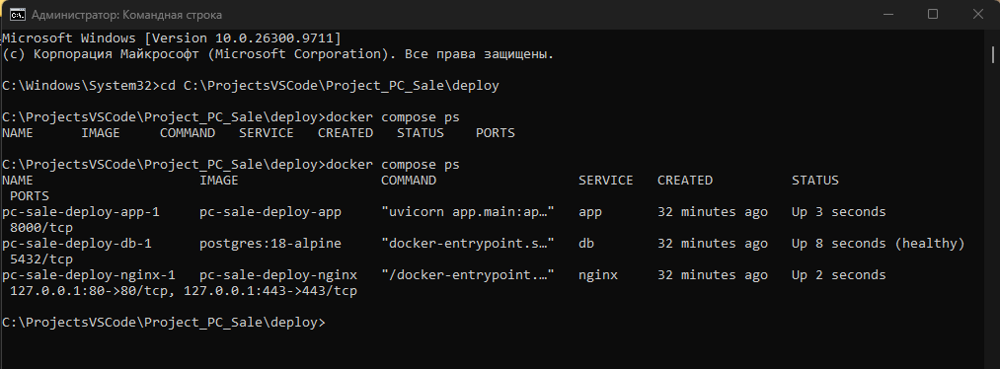
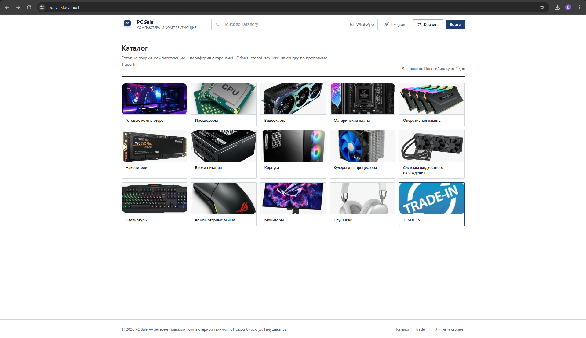
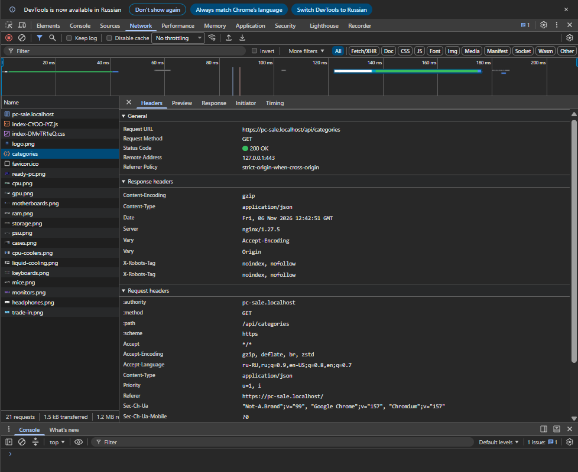
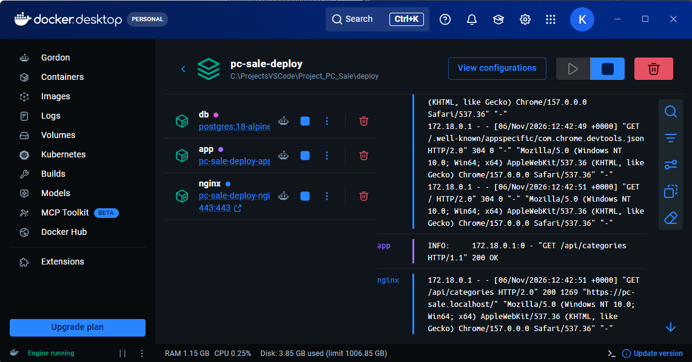
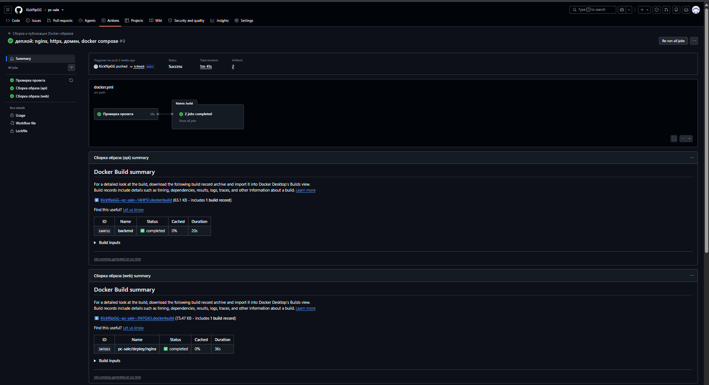

# Развёртывание проекта PC Sale

Репетиция деплоя индивидуального проекта по практическому занятию № 18
дисциплины ОПВ.15 «Проектирование, разработка и оптимизация веб-приложений».

**Выполнил:** Маренич Д. Д., группа ПР-24.103
**Репозиторий проекта:** https://github.com/KickflipGG/pc-sale

Проект развёрнут на локальном компьютере так, как он был бы развёрнут на
сервере, но **не публикуется в сети Интернет**. Причина — Федеральный закон
№ 152-ФЗ «О персональных данных»: приложение с учётными записями пользователей
должно размещаться на серверах российского провайдера, а регистрация и вход
идти через российские сервисы. Поэтому выполняется репетиция деплоя на
локальном хосте.

---

## 1. Архитектура

```
                     браузер (Chrome / Edge)
                              │
                              │  https://pc-sale.localhost  :443
                              ▼
                ┌─────────────────────────────┐
                │            nginx            │  ← единственный сервис,
                │  статика  +  прокси /api/   │    доступный снаружи
                └──────┬───────────────┬──────┘
                       │ /             │ /api/
                       │ файлы из dist │ proxy_pass
                       ▼               ▼
              index.html, JS, CSS   ┌──────────────┐
              картинки, robots.txt  │     app      │  FastAPI + uvicorn
              sitemap.xml           │   :8000      │
                                    └──────┬───────┘
                                           │ SQL :5432
                                           ▼
                                    ┌──────────────┐
                                    │      db      │  PostgreSQL 18
                                    │   :5432      │  том pgdata
                                    └──────────────┘
```

Запрос пользователя проходит так: браузер обращается к `https://pc-sale.localhost`,
запрос принимает nginx, запросы с префиксом `/api/` он передаёт приложению,
всё остальное отдаёт сам из собранного интерфейса. Приложение при
необходимости обращается к базе данных и возвращает ответ, который через
nginx уходит в браузер.

Внутренние сервисы `app` и `db` не имеют опубликованных портов: они доступны
только внутри сети Docker Compose.

---

## 2. Сервисы

| Сервис | Технология | Внутренний порт | Продакшен-сервер | Порты наружу |
|---|---|---|---|---|
| `nginx` | nginx 1.27 + собранный интерфейс | 80, 443 | nginx | **да**, `127.0.0.1:80`, `127.0.0.1:443` |
| `app` | FastAPI, Python 3.12 | 8000 | `uvicorn` без `--reload`, с `--proxy-headers` | нет |
| `db` | PostgreSQL 18 | 5432 | `postgres` | нет |

Домен: **`pc-sale.localhost`**. Имена `*.localhost` зарезервированы стандартом
RFC 6761 для обращения к своему компьютеру, регистрировать такой домен не
нужно — браузеры Chrome и Edge сами направляют его на 127.0.0.1.

Сертификат выпущен утилитой `mkcert` для этого домена, действует до 06.02.2029.

---

## 3. Переменные окружения и секреты

Фактические значения хранятся в файле `.env` рядом с `docker-compose.yml`.
В репозиторий он не попадает; имена переменных продублированы в `.env.example`.

| Имя | Назначение | Секрет |
|---|---|---|
| `POSTGRES_DB` | имя базы данных | нет |
| `POSTGRES_USER` | пользователь СУБД | нет |
| `POSTGRES_PASSWORD` | пароль пользователя СУБД | **да** |
| `DATABASE_URL` | строка подключения, собирается из трёх переменных выше | **да** — содержит пароль |
| `SECRET_KEY` | ключ подписи JWT-токенов | **да** |
| `ACCESS_TOKEN_EXPIRE_MINUTES` | срок действия токена | нет |
| `VITE_API_URL` | адрес API для интерфейса, аргумент этапа сборки | нет |

**Про `VITE_API_URL`.** Переменная передаётся аргументом сборки (`ARG`) во
втором Dockerfile, но по умолчанию остаётся пустой. Это сделано осознанно:
интерфейс и API живут на одном домене за nginx, поэтому клиент обращается к
относительному `/api`, а пустое значение как раз даёт такой адрес. Если
подставить `/api`, получился бы `/api/api/...` — клиент добавляет префикс сам.

**Про секреты.** Пароль базы и ключ подписи передаются контейнерам как
переменные окружения из `.env`. В примере из методички используется раздел
`secrets:` — там секретом был файл ключа Firebase. У нас секреты являются
строками, а не файлами, поэтому штатный путь для них — переменные окружения;
файл `.env` не попадает ни в репозиторий, ни в образ. Для реального сервера
эти значения выносятся в хранилище секретов или в секреты CI.

---

## 4. Команды

Все команды выполняются в папке `deploy/`.

```bash
# Собрать образы и запустить сервисы в фоне
docker compose up --build -d

# Состояние сервисов
docker compose ps

# Журнал конкретного сервиса
docker compose logs app
docker compose logs nginx
docker compose logs db

# Остановить и удалить контейнеры (том с данными сохраняется)
docker compose down
```

После запуска проект открывается по адресу **https://pc-sale.localhost**.
Обращение по `http://` автоматически перенаправляется на HTTPS кодом 301.

Важно: после любых изменений в коде образы нужно пересобирать той же
командой с флагом `--build`, иначе изменения не попадут в контейнеры.

---

## 5. Скриншоты

| Скриншот | Что показывает |
|---|---|
|  | все три сервиса в состоянии `Up`, порты только у nginx |
|  | `https://pc-sale.localhost` с замком в адресной строке |
|  | запрос к API и заголовок `X-Robots-Tag` в ответе |
|  | контейнеры проекта: порты открыты только у nginx |
|  | успешная сборка образов обоих сервисов |

---

## 6. Ошибки и замечания, возникшие при выполнении работы

**1. Инициализация базы данных падала бы при передаче `POSTGRES_DB` в контейнер.**

Скрипт `backend/database/01_schema.sql` начинается с `DROP DATABASE IF EXISTS pc_sale`
и `CREATE DATABASE pc_sale`. Если передать имя базы в переменной `POSTGRES_DB`,
официальный образ PostgreSQL при старте подключается именно к этой базе, и
`DROP DATABASE` завершается ошибкой «cannot drop the currently open database».

*Решение:* переменная `POSTGRES_DB` в сервис `db` не передаётся. Entrypoint
подключается к базе `postgres`, скрипт сам создаёт `pc_sale` и переключается
на неё через `\connect`. Переменная остаётся в `.env`, потому что нужна для
сборки `DATABASE_URL` у приложения.

**2. `curl` на Windows не мог проверить HTTPS.**

Обращение к `https://pc-sale.localhost` из `curl` завершалось ошибкой
`schannel: CRYPT_E_NO_REVOCATION_CHECK`: встроенный в Windows curl проверяет
списки отзыва сертификатов, а у локального центра сертификации `mkcert` таких
списков нет.

*Решение:* это ограничение клиента, а не сервера — браузеры проверяют такой
сертификат нормально. Для проверки из командной строки используется флаг
`curl --ssl-no-revoke`, он отключает только проверку отзыва, оставляя
проверку цепочки доверия.

**3. Дублирование заголовка `X-Robots-Tag`.**

Заголовок выставляется дважды: промежуточным звеном в приложении (сделано на
занятии 70–71) и директивой `add_header` в nginx. Дублирование безвредно —
оба значения одинаковые, — но при желании одно из мест можно убрать. В
приложении заголовок нужен для запуска без nginx, в nginx — как единая точка
для всех ответов API.

---

## 7. Что нужно изменить для публикации на реальном сервере

1. **Арендовать сервер** у российского провайдера (требование 152-ФЗ) —
   виртуальный сервер с Linux и установленным Docker.
2. **Зарегистрировать домен** и создать A-запись, указывающую на IP сервера.
   Заменить `pc-sale.localhost` на реальное имя в `nginx.conf` и `server_name`,
   а `https://example.com` — в `sitemap.xml` и `robots.txt`.
3. **Получить настоящий сертификат** у Let's Encrypt через Certbot
   (действует 90 дней и продлевается автоматически) и подключить его вместо
   сертификата `mkcert`.
4. **Убрать привязку к `127.0.0.1`** в разделе `ports` сервиса nginx и открыть
   80 и 443 в фаерволе сервера.
5. **Перенести секреты** из файла `.env` в хранилище секретов (или в секреты
   CI) и не хранить их на диске сервера в открытом виде.
6. **Настроить CD:** на сервере забирать готовые образы из GitHub Container
   Registry и перезапускать контейнеры — по SSH из GitHub Actions или через
   отдельный скрипт на сервере.
7. **Добавить эксплуатационные вещи:** резервное копирование базы, мониторинг
   и сбор журналов, ограничение доступа к документации API (`/docs`).

Порядок развёртывания при этом не меняется: те же образы, тот же
`docker-compose.yml`, та же схема с nginx.

---

## 8. Непрерывная интеграция

Workflow `.github/workflows/docker.yml` на каждое изменение в репозитории:

1. поднимает служебную PostgreSQL, применяет схему и демонстрационные данные;
2. собирает интерфейс и прогоняет дымовой тест API;
3. собирает Docker-образы **обоих** сервисов — `pc-sale-api` и `pc-sale-web`
   (матричная сборка, задание «Сборка образа»).

На pull request образы только собираются, публикация выполняется лишь из
основной ветки. При публикации образы уходят в GitHub Container Registry:
`ghcr.io/kickflipgg/pc-sale-api` и `ghcr.io/kickflipgg/pc-sale-web`.

Публикация образов и доставка их на сервер — это уже CD (Continuous Delivery);
в работе настроена её первая половина: автоматическая сборка и помещение
образов в реестр.
