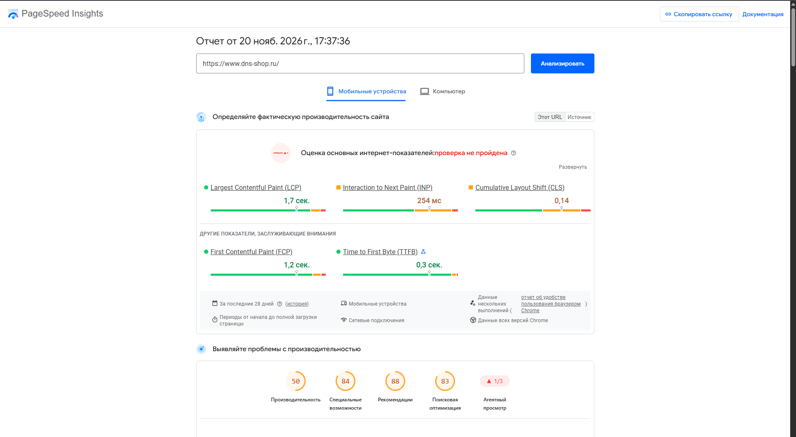

# Аудит проекта PC Sale

Практическое занятие № 19 «SEO и аналитика: проверка метатегов, sitemap, Lighthouse,
Core Web Vitals».

**Выполнил:** Маренич Д. Д., группа ПР-24.103
**Репозиторий:** https://github.com/KickflipGG/pc-sale

Аудит проводился на **продакшен-версии** проекта, развёрнутой на занятии 18:
`https://pc-sale.localhost` — nginx, HTTPS с локальным сертификатом, три контейнера
Docker Compose. Сервер разработки не использовался: он отдаёт код без сжатия и
минификации и добавил бы к результатам служебные скрипты.

Замеры выполнялись в окне инкогнито, Lighthouse: режим **Navigation**,
устройство **Desktop**, все четыре категории.

---

## 1. Проверенные страницы

| Страница | Тип страницы | Как проверялась | Категории |
|---|---|---|---|
| `/` | публичная, есть в `sitemap.xml` | инкогнито, 3 запуска | все 4 |
| `/catalog` | публичная, есть в `sitemap.xml` | инкогнито, 3 запуска | все 4 |
| `/category/ready-pc` | публичная, есть в `sitemap.xml` | инкогнито, 3 запуска | все 4 |
| `/product/gpu-rtx5070ti-16g` | публичная, есть в `sitemap.xml` | инкогнито, 3 запуска | все 4 |
| `/trade-in` | публичная, есть в `sitemap.xml` | инкогнито, 3 запуска | все 4 |
| `/login` | метатег `noindex` | инкогнито, 3 запуска | без SEO |
| `/account` | после входа | вход в том же окне, 1 запуск | без SEO |
| `/cart` | после входа | вход в том же окне, 1 запуск | без SEO |
| `/checkout` | после входа | вход в том же окне, 1 запуск | без SEO |

В `sitemap.xml` проекта 43 адреса. Полностью проверены пять публичных страниц —
по одной на каждый тип (главная, каталог, корневая категория, карточка товара,
страница Trade-In). Остальные 38 адресов — те же шаблоны категорий и товаров,
поэтому отдельно не замерялись.

Страницы, закрытые от индексации, проверялись **без категории SEO**: Lighthouse в ней
проверяет, можно ли проиндексировать страницу, и для намеренно закрытых показывает
ошибку. Для контроля отдельно замерены `/login` и `/cart` **с** SEO —
обе получили 66 баллов ровно из-за проваленной проверки «Page is blocked from indexing»
(`/login` закрыт метатегом, `/cart` — директивой `Disallow` в `robots.txt`). Это
подтверждает, что блокировка работает.

---

## 2. Результаты Lighthouse

Проверки выполнялись по три раза на страницу. Оценки Accessibility, Best Practices и
SEO во всех запусках совпали, поэтому для них указано одно значение.

| Страница | Performance (3 запуска) | Медиана | Accessibility | Best Practices | SEO |
|---|---|---|---|---|---|
| `/` | 99, 99, 99 | **99** | 100 | 100 | 100 |
| `/catalog` | 100, 100, 100 | **100** | 100 | 100 | 100 |
| `/category/ready-pc` | 100, 98, 99 | **99** | 100 | 100 | 100 |
| `/product/gpu-rtx5070ti-16g` | 96, 96, 96 | **96** | 100 | 100 | 100 |
| `/trade-in` | 100, 100, 100 | **100** | 100 | 100 | 100 |
| `/login` | 100, 100, 100 | **100** | 100 | 100 | — |
| `/account` | 100 | **100** | 95 было; после правки контраста не перепроверялась | 100 | — |
| `/cart` | 100 | **100** | **100** | 100 | — |
| `/checkout` | 100 | **100** | 100 | 100 | — |

Разброс виден только у `/category/ready-pc`: 100, 98 и 99. Медиана — 99. Именно
поэтому одного запуска недостаточно.

**Метрики запусков с медианной оценкой:**

| Страница | FCP | LCP | TBT | CLS | Speed Index |
|---|---|---|---|---|---|
| `/` | 0,2 с | 1,0 с | 0 мс | 0,001 | 0,3 с |
| `/catalog` | 0,2 с | 0,5 с | 0 мс | 0 | 0,2 с |
| `/category/ready-pc` | 0,2 с | 1,0 с | 0 мс | 0 | 0,2 с |
| `/product/...` | 0,2 с | 0,4 с | 0 мс | 0,122 | 0,2 с |
| `/trade-in` | 0,2 с | 0,2 с | 0 мс | 0 | 0,2 с |
| `/login` | 0,2 с | 0,2 с | 0 мс | 0 | 0,2 с |

Отчёты Lighthouse в формате HTML — в папке [`reports/`](reports/), по файлу на страницу
(сохранён первый запуск каждой страницы).

---

## 3. Core Web Vitals вживую

Замер на `/catalog` во вкладке Performance: страница загружена, затем выполнены
действия покупателя — поиск, сортировка, переход по категориям, добавление товара
в корзину.

| Метрика | После загрузки | После работы со страницей | Оценка |
|---|---|---|---|
| LCP | 0,09 с | 0,05 с | хорошо |
| CLS | 0 | 0 | хорошо |
| INP | 0 мс | **24 мс** | хорошо |

Самое долгое взаимодействие — нажатие кнопки «В корзину»: задержка ввода 0 мс,
обработчик 1 мс, отрисовка 23 мс. То есть отклик ограничен перерисовкой списка,
а не логикой приложения. Все действия уложились в 16–24 мс.

| Пороговые значения | хорошо | требует улучшения | плохо |
|---|---|---|---|
| LCP | до 2,5 с | 2,5–4 с | больше 4 с |
| INP | до 200 мс | 200–500 мс | больше 500 мс |
| CLS | до 0,1 | 0,1–0,25 | больше 0,25 |

Скриншоты: [`01-live-metrics-load.png`](screenshots/01-live-metrics-load.png),
[`02-live-metrics-actions.png`](screenshots/02-live-metrics-actions.png),
[`03-interactions.png`](screenshots/03-interactions.png),
[`04-live-metrics-product.png`](screenshots/04-live-metrics-product.png).

### Расхождение живых метрик и Lighthouse

На `/catalog` Lighthouse показал CLS 0,895, а живые метрики в том же браузере — 0.
Чтобы понять причину, сдвиги макета замерены напрямую через `PerformanceObserver`:

- без искусственного замедления сети — CLS 0,0699;
- с замедлением до 10 Мбит/с и задержкой 40 мс (как в режиме Desktop) — тоже 0,0699.

То есть расхождение не связано с троттлингом и различается в 12–13 раз стабильно.
При этом после исправления заглушек каталога Lighthouse показал ровно 0 — значит
инструмент чувствителен к реальным изменениям, и его число нельзя списать на
погрешность. Вывод для отчёта: **абсолютные значения CLS у Lighthouse и у живых
метрик расходятся, но направление изменений совпадает**, поэтому опираться нужно
на Lighthouse как на инструмент, которым пользуется Google.

Второе расхождение — то же, о котором предупреждает методичка: живые метрики сняты
одним пользователем на мощном компьютере и локальном сервере, поэтому они заведомо
лучше полевых данных реальных пользователей.

---

## 4. Ручные проверки

| Проверка | Результат | Комментарий |
|---|---|---|
| Атрибут `lang` у `<html>` | есть, `lang="ru"` | |
| Тег `<title>` | есть | «PC Sale — компьютеры и комплектующие» — **одинаковый на всех 43 страницах** |
| Метатег `description` | есть | описывает магазин в целом, но **не конкретную страницу** |
| Содержимое в исходном HTML | **отсутствует** | в `view-source` только `<div id="root"></div>`; товары и категории появляются после выполнения JavaScript |
| Атрибут `alt` у картинок | есть у всех | Lighthouse это подтверждает |
| Метатег `noindex` | есть на `/login` | |
| Файл `robots.txt` | открывается | 7 директив `Disallow`, указан адрес `sitemap.xml` |
| Файл `sitemap.xml` | открывается, 43 адреса | ни один адрес из карты не закрыт в `robots.txt` |
| Навигация с клавиатуры | фокус виден | обводка появляется на логотипе, ссылках и кнопках |
| Адаптивная вёрстка | **есть** | два `@media` (1080 и 760 px), на экране телефона всё читается |
| Метатеги на страницах с `noindex` не противоречат `robots.txt` | в порядке | |

Скриншоты: [`05-view-source-catalog.png`](screenshots/05-view-source-catalog.png),
[`06-view-source-noindex.png`](screenshots/06-view-source-noindex.png),
[`07-robots-txt.png`](screenshots/07-robots-txt.png),
[`08-sitemap-xml.png`](screenshots/08-sitemap-xml.png),
[`09-keyboard-focus.png`](screenshots/09-keyboard-focus.png),
[`10-mobile.png`](screenshots/10-mobile.png).

**Главная находка ручных проверок:** сайт рендерится на клиенте (CSR), поэтому
поисковый робот получает пустую страницу с одинаковыми метатегами. Google умеет
выполнять JavaScript, поэтому страницы в индекс попадут, но:
заголовки результатов поиска будут одинаковыми у всех 43 адресов, а содержимое
появится только после рендеринга.

---

## 5. Сравнение с замерами занятия 70–71

На занятии 70–71 замерялась только категория SEO, до и после исправлений.

| Замер | SEO | Что было сделано |
|---|---|---|
| `docs/seo/before.png` | 92 | исходное состояние, `robots.txt` не отдавался |
| `docs/seo/after.png` | 100 | добавлены `robots.txt` и `sitemap.xml`, исправлены заголовки |
| текущий аудит | 100 на всех публичных страницах | дополнительно закрыты проблемы доступности |

SEO-составляющая с тех пор не ухудшилась. Основные проблемы, найденные сейчас,
лежат в двух других категориях — Performance и Accessibility, которые на занятии
70–71 не проверялись.

---

## 6. Найденные проблемы и приоритеты

Приоритет расставлен по влиянию, а при равном влиянии — по сложности.

| Приоритет | Проблема | Страница | Влияние | Сложность | Как исправить |
|---|---|---|---|---|---|
| 1 | Сетка товаров появляется после ответа API, страница прыгает: **CLS 0,895** | `/catalog` | высокое | средняя | Показывать карточки-заглушки, держащие высоту сетки |
| 2 | `<dl class="spec-list">` содержит `<li>` — сразу две ошибки доступности (`dlitem`, `listitem`) | `/catalog`, `/product` | высокое | низкая | Обернуть `dt`/`dd` в `div` вместо `li` |
| 3 | Низкий контраст подписей полей: `#8a93a1` на белом = **3,1:1** при 10,5 px | `/product`, `/account` | высокое | низкая | Затемнить цвет до 4,5:1 |
| 4 | `<div role="dialog">` без доступного имени | `/login` | высокое | низкая | Добавить `aria-labelledby` на заголовок модалки |
| 5 | Пропуск уровня заголовков: `h1 → h3` в пустых состояниях | `/cart`, `/checkout`, `/payment`, `/history`, `/reviews` | высокое | низкая | Заменить `h3` на `h2` |
| 6 | Пустой исходный HTML и одинаковые метатеги на всех страницах (CSR) | все | высокое | **высокая** | Нужен серверный рендеринг — отдельная работа |
| 7 | Нет `Cache-Control` у статики, «экономия» 1002 КБ | все | среднее | низкая | `expires 1y` для файлов с хешем в имени |
| 8 | CLS 0,122 на карточке товара | `/product` | среднее | средняя | Не установлено, см. п. 9 |
| 9 | Картинки товаров сжаты слабо, «экономия» 847 КБ | `/catalog` | среднее | средняя | Пережать и уменьшить до размера показа |
| 10 | Неиспользуемый JavaScript, около 40 КБ | все | низкое | высокая | Разделение кода и ленивая загрузка |

---

## 7. Что исправлено

| Проблема | Было | Стало |
|---|---|---|
| CLS на `/catalog` | **0,895** | **0** |
| Performance `/catalog` | **76** | **100** |
| Accessibility `/catalog` | 92 | **100** |
| Accessibility `/product` | 88 | **100** |
| Accessibility `/login` | 96 | **100** |
| Accessibility `/cart` | 98 | **100** |
| Cache-Control статики | не было | `expires 1y` |
| Best Practices | 100 → 96 (после правки nginx) | **100** |

Что сделано в коде:

- **`frontend/src/components/ProductCard.jsx`, `pages/ProductPage.jsx`** — `dt`/`dd`
  обёрнуты в `div` вместо `li`; в `global.css` селектор `.spec-list li` заменён на
  `.spec-list > div`;
- **`frontend/src/styles/global.css`** — цвет `.info-row__label` сменён с
  `--muted-light` (#8a93a1, контраст 3,1:1) на `--muted` (#5b6472, контраст 5,8:1);
  добавлен стиль `.product-card--skeleton` для заглушек;
- **`frontend/src/components/AuthModal.jsx`** — у диалога появились `aria-modal="true"`
  и `aria-labelledby="auth-modal-title"`, у заголовка — `id`;
- **`frontend/src/pages/CatalogPage.jsx`** — вместо короткой надписи «Загрузка товаров…»
  выводятся четыре карточки-заглушки, которые держат высоту будущей сетки;
- **`frontend/src/pages/ProductPage.jsx`** — заглушка загрузки занимает 700 px;
- **пять страниц** — `h3` в пустых состояниях заменены на `h2`, в CSS добавлен
  селектор `.empty-state h2`;
- **`deploy/nginx/nginx.conf`** — добавлен `location` с `expires 1y` для файлов с
  хешем в имени; префикс `location /api/` получил `^~`, чтобы регулярное выражение
  статики не перехватывало запросы к API;
- **`frontend/index.html`** — добавлена иконка `<link rel="icon">`.

**Отдельная ошибка, которую я допустил и исправил.** После добавления `expires`
файл `/favicon.ico` начал отдавать 404 вместо `index.html`, ошибка попала в консоль
браузера, и Best Practices упал со 100 до 96 на всех страницах. Исправлено настоящей
иконкой в `index.html`. Это хороший пример того, что исправление одной проблемы
может создать другую, и повторный замер обязателен.

---

## 8. Сравнение с сайтом-аналогом

Выбран **https://www.dns-shop.ru** — крупная сеть магазинов цифровой и бытовой
техники, тематика совпадает с нашим проектом.



PageSpeed Insights, вкладка «Мобильные устройства». Слева — полевые данные из отчёта
Chrome UX Report за 28 дней, справа — лабораторная проверка Lighthouse на серверах
Google.

| Показатель | Наш проект (лабораторные, Desktop) | DNS: полевые данные (мобильные) | DNS: Lighthouse (мобильные) |
|---|---|---|---|
| LCP | 0,5 с | 1,7 с | 16,9 с |
| INP | 24 мс (живые метрики) | 254 мс | — |
| CLS | 0 (каталог), 0,122 (товар) | 0,14 | 0,046 |
| FCP | 0,2 с | 1,2 с | 5,7 с |
| Performance | 100 | — | **50** |
| Accessibility | 100 | — | 84 |
| Best Practices | 100 | — | 88 |
| SEO | 100 | — | 83 |

**Выводы:**

1. **У аналога проверка Core Web Vitals не пройдена**, хотя LCP у него хороший
   (1,7 с): INP 254 мс и CLS 0,14 попадают в «требует улучшения». У нас INP 24 мс
   и CLS 0 на каталоге, то есть по отзывчивости и визуальной стабильности проект
   не хуже крупного магазина.
2. **Лабораторные и полевые данные расходятся в разы.** Lighthouse для DNS
   показывает LCP 16,9 с и Performance 50, а полевые данные того же сайта — 1,7 с.
   Причина в условиях: PageSpeed эмулирует Moto G Power и медленное 4G, тогда как
   полевые данные — это 75-й процентиль по реальным посетителям за 28 дней.
   Наши 100 баллов получены на Desktop и локальном сервере, поэтому напрямую
   сравнивать их с 50 у DNS нельзя — сравнивать можно только характер проблем.
3. **По доступности и SEO мы выигрываем:** 100 и 100 против 84 и 83. При этом у нас
   вдвое больше проблем в производительности, которые мы ещё не закрыли (см. п. 9).

---

## 9. Что осталось неисправленным и почему

| Проблема | Почему не исправлена |
|---|---|
| **CSR: пустой исходный HTML и одинаковые метатеги** | Требует перевода проекта на серверный рендеринг (Next.js или React Router с SSR). Это переработка архитектуры фронтенда, а не правка в рамках аудита. Записано как задача на следующее занятие про метатеги. |
| **CLS 0,122 на карточке товара** | Причину установить не удалось. Попытка исправить резервированием высоты заглушки (700 px) результата не дала — значение осталось ровно 0,122. Отчёт указывает на `main.container`, но что именно его сдвигает, не выяснено. Проблема попадает в диапазон «требует улучшения», но не «плохо». |
| **Тяжёлые картинки товаров, 847 КБ** | Требует пакетной обработки 26 файлов и проверки внешнего вида карточек после сжатия. Отложено как задача с низким влиянием на текущие метрики. |
| **Неиспользуемый JavaScript, 40 КБ** | Требует разделения бандла и ленивой загрузки маршрутов — это тема отдельного занятия. Влияние низкое, TBT равен нулю. |
| **Три страницы после входа проверены одним запуском** | Методичка допускает один запуск для таких страниц: в них обязательно появляется предупреждение Lighthouse о сохранённых данных (авторизация хранится в `localStorage`), из-за чего точность замера ниже. |
| **`/account` перепроверена не была** | Низкий контраст подписей полей на этой странице исправлен тем же правилом CSS, что и на карточке товара, но повторный замер требует входа в аккаунт. Скриншот `11-lighthouse-account.png` фактически снят на `/login`: без авторизованной сессии `/account` переадресует на страницу входа. Результат на нём — 100/100/100 при CLS 0, что подтверждает исправление доступности на этой странице, но относится к `/login`. |

---

## Приложение

```
docs/audit/
├── README.md            этот отчёт
├── reports/             HTML-отчёты Lighthouse, по файлу на страницу
│   ├── home.html, catalog.html, category-ready-pc.html,
│   ├── product.html, trade-in.html, login.html
└── screenshots/
    ├── 01–04  живые метрики и Interactions
    ├── 05–08  исходный HTML, noindex, robots.txt, sitemap.xml
    ├── 09–10  клавиатура и мобильная вёрстка
    ├── 11–13  Lighthouse после исправлений: 11 — `/login`, 12 — `/cart`, 13 — `/checkout`
    ├── 14     PageSpeed Insights для сайта-аналога: полевые данные
    └── 15     PageSpeed Insights для сайта-аналога: оценки Lighthouse
```

Скриншоты страниц после входа сделаны так, чтобы в кадр не попадали имя
пользователя, почта и адрес доставки.
